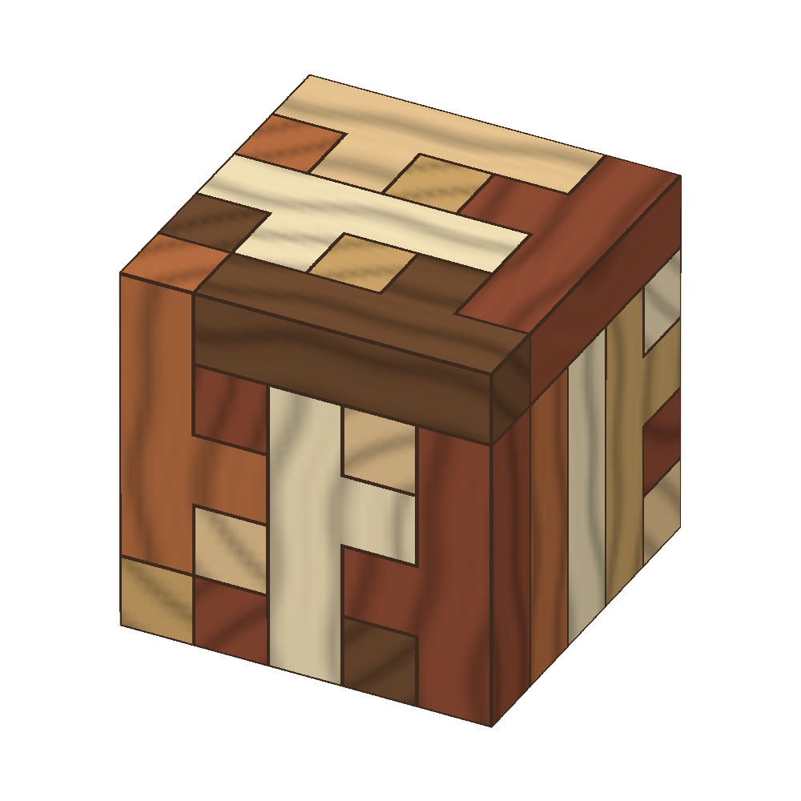
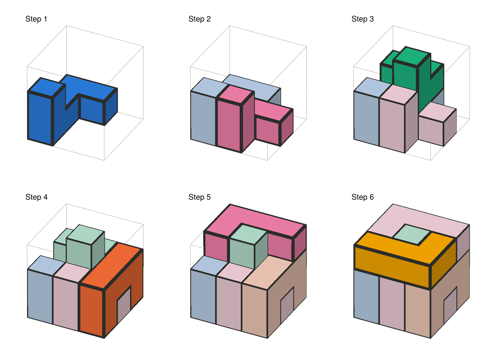
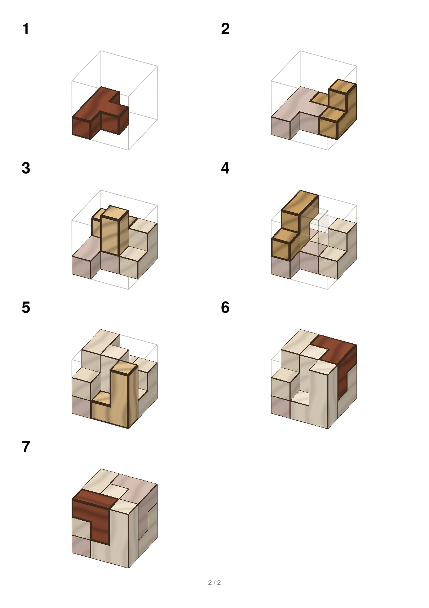
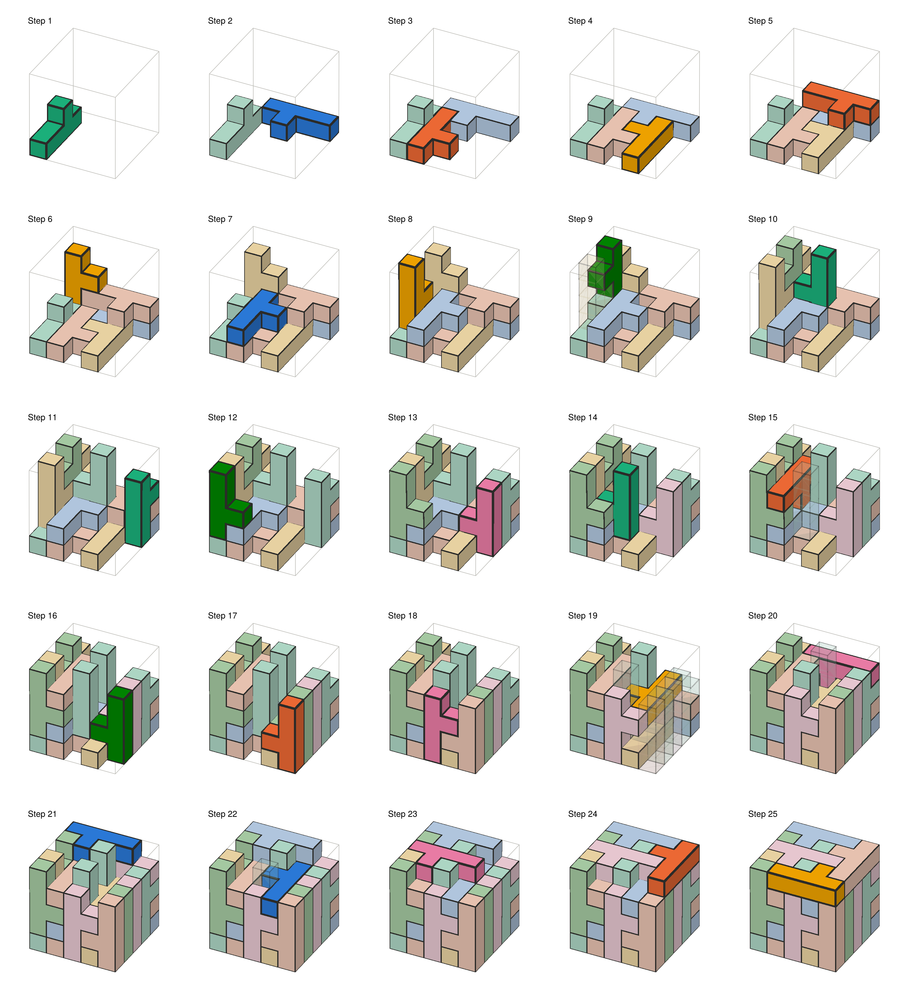

# PolycubePuzzles.jl

[](https://mcvmcv.github.io/PolycubePuzzles.jl/dev/)
[](https://github.com/mcvmcv/PolycubePuzzles.jl/actions/workflows/CI.yml)

Solve packing puzzles in any dimension: fill a target region with a given
multiset of pieces (polyominoes, polycubes, ...), enumerate all solutions,
count them up to symmetry, and plot step-by-step assembly instructions.
See the [documentation](https://mcvmcv.github.io/PolycubePuzzles.jl/dev/) for a
full guide.



```julia
using PolycubePuzzles

Y = shape"""
XXXX
.X..
"""
Y3 = Shape([(c..., 1) for c in Y])          # the same piece in 3D
p = Puzzle(box(5, 5, 5), Y3 => 25)

solve(p; limit = 1)                          # one solution, printed layer by layer
count_solutions(p)                           # 60672
count_solutions(p; symmetry = :all)          # 1264 up to rotation and reflection
count_solutions(p; symmetry = :all, swaps = true)   # 106, ignoring swapped pairs
```

## Example: a 3×3×3 cube from six pieces

Give each piece as the cells it occupies in a known solution. The pieces'
shapes come from those cells, and `Solution` checks that they really solve the
puzzle (no overlaps, gaps, or cells outside the cube):

```julia
using PolycubePuzzles

pieces = [
    [(1,3,1), (2,3,1), (3,3,1), (3,2,1), (1,3,2)],
    [(1,2,1), (2,2,1), (2,1,1), (1,2,2)],
    [(1,1,1), (3,1,1), (1,1,2), (2,1,2), (3,1,2)],
    [(2,2,2), (3,2,2), (3,3,2), (2,2,3)],
    [(2,3,2), (2,3,3), (3,3,3), (3,2,3), (3,1,3)],
    [(2,1,3), (1,1,3), (1,2,3), (1,3,3)],
]
p = Puzzle(box(3, 3, 3), [Shape(c) => 1 for c in pieces])

count_solutions(p; symmetry = :rotations)   # 24 different solutions
sol = Solution(p, pieces)                   # the one above

using CairoMakie
plot_steps(sol; columns = 3)
```



Four of the pieces differ from their mirror images and none of their mirror
images is in the set, so a mirrored solution can't be built:
`symmetry = :all` also gives 24.

## Describing puzzles

**Shapes** are finite sets of integer cells, `Shape{N}`, 1-based:

- `Shape((1,1), (2,1), (2,2))` from coordinate tuples (any dimension),
- `Shape(A)` from a `Bool` array,
- `box(5, 5, 5)` for boxes,
- `shape"..."` from ASCII art. `.` and spaces are empty, any other character is
  a cell; columns are x, lines are y with the **bottom line y = 1**; blocks
  separated by blank lines are the z-layers of a 3D shape, **bottom layer first**,
- `union`, `intersect`, `setdiff` for anything else, e.g. a board with a hole:
  `setdiff(box(8, 8), Shape([(x, y) for x in 4:5 for y in 4:5]))`.

**Puzzles** pair a target with pieces and counts:

```julia
Puzzle(target, [pieceA => 1, pieceB => 3, pieceC => 0:2]; reflections = false)
```

A count is exact (`3`) or a range (`0:2`, for spare pieces). Copies of a piece
are indistinguishable, so permuting them never yields a "new" solution.
`reflections` says whether pieces may be mirrored. It is off by default; turn
it on for flat tiles that may be turned over, e.g. the classic pentomino
puzzles: `Puzzle(box(10, 6), [s => 1 for s in pentominoes()]; reflections = true)`.

The library has `pentominoes()` and `soma()`.

## Solving

- `solve(p; limit, symmetry, swaps, ntasks)` returns a `Vector{Solution}`,
- `count_solutions(p; symmetry, swaps, ntasks)` counts without storing,
- `foreach_solution(f, p; symmetry, swaps, ntasks)` streams solutions to `f`;
  return `false` to stop.

`symmetry = :all` counts solutions related by a symmetry of the target once
(reflections included when they map solutions to solutions, e.g. the Soma
cube's mirror-twin screws swap places); `:rotations` identifies rotations only;
`:none` (the default) counts every solution. The reduction is exact and also
prunes the search.

`swaps = true` also counts solutions once that differ only by two touching
pieces trading places, their cells together filled by the same two pieces
another way (in the 5×5×5 cube, two Ys side by side with their nubs together
can swap nubs). This needs every solution found, so it is no faster than
`solve`.

`ntasks` splits the search tree over concurrent tasks; start Julia with
`julia --threads=auto` to use all cores. `solve` and `count_solutions` default
to `Threads.nthreads()`.

Each piece type has a counter in place of one constraint per copy, so identical
copies are never told apart. There are two search engines: a bitboard search
(fastest for most flat puzzles) and Knuth's dancing links (Algorithm X, far
faster on puzzles like the 5×5×5 cube). By default (`engine = :auto`) a quick
random-probe estimate picks the faster one; pass `engine = :dlx` or
`engine = :bitboard` to choose.

## Assembly instructions and plots

`assembly_order(sol)` orders the pieces bottom-up so each one rests on the floor
or on pieces already placed. Every piece can be slid into place when its turn
comes, and the rest can still be added afterwards, whenever the solution can be
built that way at all: `insertion` and `assembly_plan` say how each piece goes
in (dropped, slid in from one side, or along a route of slides), and
`isassemblable` says whether a solution can be built one piece at a time. Given
a viewing direction, the order builds from the back and left, preferring
pieces that will be visible. `piece_coloring(sol)` colours pieces so touching
pieces differ.

Plotting is a package extension, loaded with any Makie backend:

```julia
using CairoMakie                          # or GLMakie for interactive 3D
plot_solution(sol)                        # the finished puzzle
plot_steps(sol)                           # one numbered panel per step
plot_steps(sol; style = :wood)            # ... in wood
animate_assembly(sol, "assembly.gif")     # one frame per step
instructions(sol, "booklet.pdf")          # printable A4 booklet (needs CairoMakie)
explore(sols)                             # step through and browse solutions (GLMakie)
```

Each step shows the piece just placed with a heavy outline and the earlier
pieces muted; any placed piece that would hide the new one is drawn as a faint
ghost, and a piece that must slide in from the side gets an arrow and a note
in the step title. Keywords: `style` (`:flat` or `:wood`), `colors`,
`azimuth`, `elevation`, `order`, `muted`, `ghost`, `arrows`, `frame`.

`instructions` writes a title page (the parts, each kind of piece drawn on its
own with how many there are, and the finished puzzle) and then the numbered
steps, `steps_per_page` to a page, as one PDF or one image per page. `explore`
opens an interactive window with sliders for the step and the solution, arrow
key shortcuts, and toggles for wood, ghosts, arrows and muting.

The Soma cube's steps from `instructions(sol, "soma.pdf"; style = :wood,
steps_per_page = 8)`:



The 25 Y pentacubes in the 5×5×5 cube:



The figures are made by `examples/figures.jl`.
