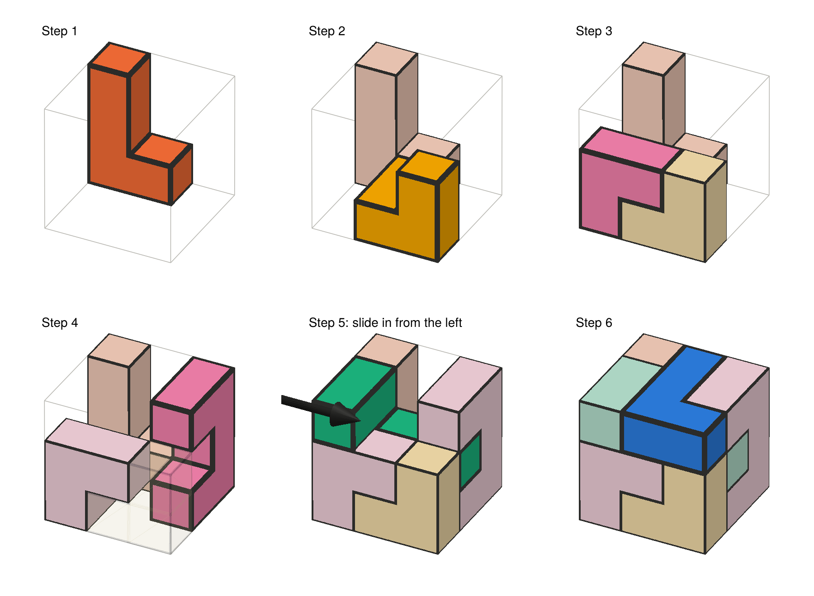
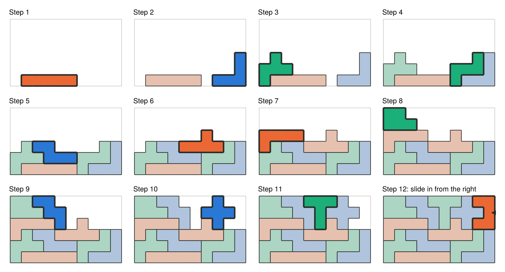
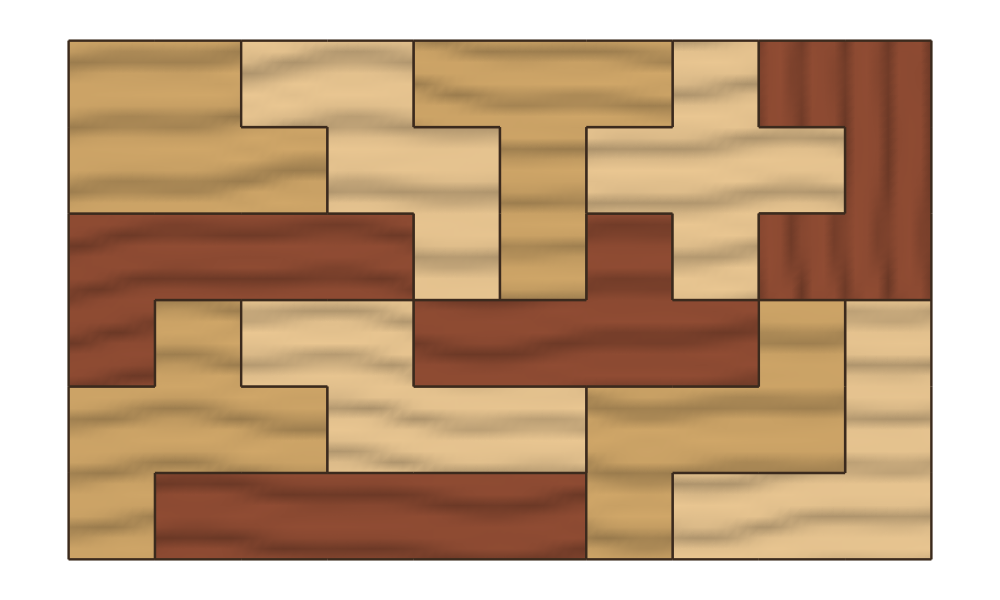
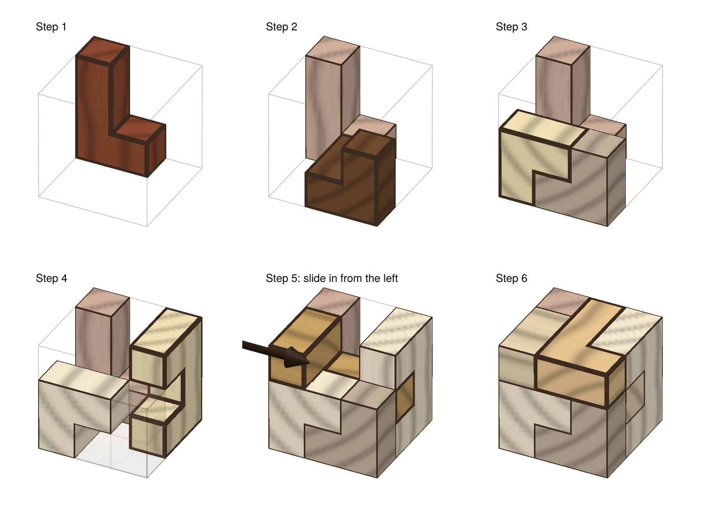

# Assembly and plots

## Building order

[`assembly_order`](@ref) chooses an order in which to put a solution together
by hand. Pieces go in bottom-up, each resting on the floor or on pieces
already placed. When the order is for a picture (`view` and `right`
directions are given; the plotting functions do this themselves), it also
builds from the back and left and prefers pieces that will be visible, so
each new piece lands in front of the work so far.

## Sliding pieces in

A piece can't always be dropped in from above: part of it may need to tuck
under an overhang. [`insertion`](@ref) works out how a piece can be moved into
place, given the pieces already there, as an [`Insertion`](@ref):

- `:drop`: lowered straight down;
- `:slide`: pushed straight in from one side;
- `:path`: a route of several straight slides;
- `:blocked`: it can't get in at all.

Pieces never pass through the floor. [`assembly_plan`](@ref) gives the
insertion for every step of an order, and [`isassemblable`](@ref) says whether
a solution can be built one piece at a time at all.

The order from [`assembly_order`](@ref) never paints itself into a corner:
each piece it picks can be slid into place, and the remaining pieces can still
all be added afterwards, whenever the solution can be built that way at all.
This can be checked quickly, because removing a piece from a partly built
puzzle never stops another piece from being removed. So taking pieces off the
finished puzzle, in any workable order, shows whether a set of pieces can be
built, and the reverse of that order is a way to build it.

For the 3×3×3 puzzle from the [home page](../index.md), 10 of its 24 solutions need a
piece slid in from the side. The instructions say so and show the way in with
an arrow:



## Plots

Plotting is provided by a package extension. Load a Makie backend to use it:

```julia
using CairoMakie                         # or GLMakie for interactive 3D
plot_solution(sol)                       # the finished puzzle
plot_steps(sol)                          # one numbered panel per step
animate_assembly(sol, "assembly.gif")    # one frame per step
```

In each step the piece just placed is drawn in full colour with a heavy
outline, and the pieces before it are muted. In 3D, a placed piece that would
hide the new one from view is drawn as a faint ghost, so pieces that go inside
the shape can still be seen.

Pieces are coloured so that touching pieces always differ
([`piece_coloring`](@ref)). Colours never carry meaning on their own, since
every piece also has an outline.



## Wood

`style = :wood` draws the pieces as wood. Each piece gets a wood tone, with
grain running along its length that wraps around its corners:

```julia
plot_solution(sol; style = :wood)
plot_steps(sol; style = :wood)
```





Pass `colors` to choose your own colours or wood tones.
